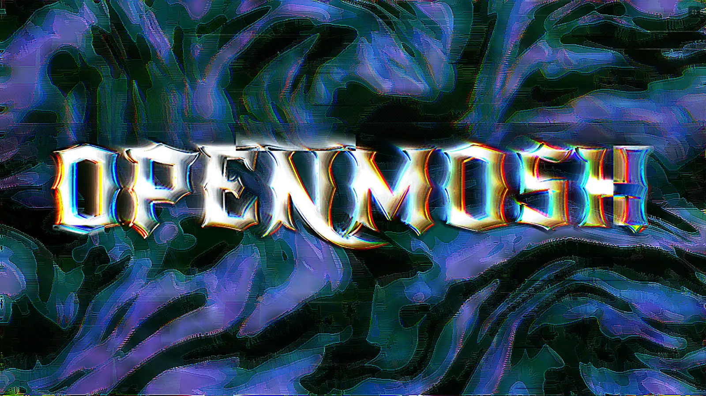
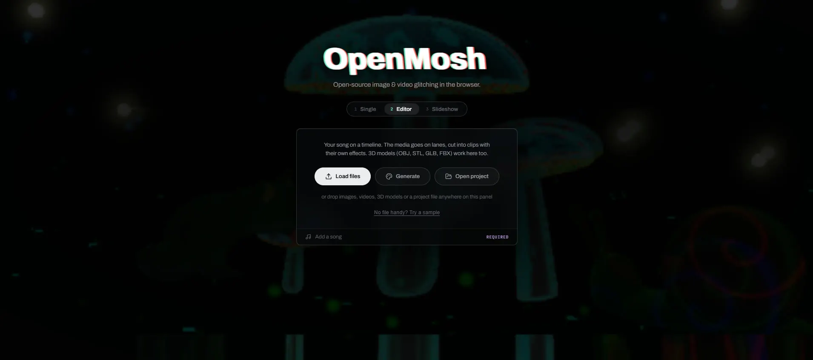
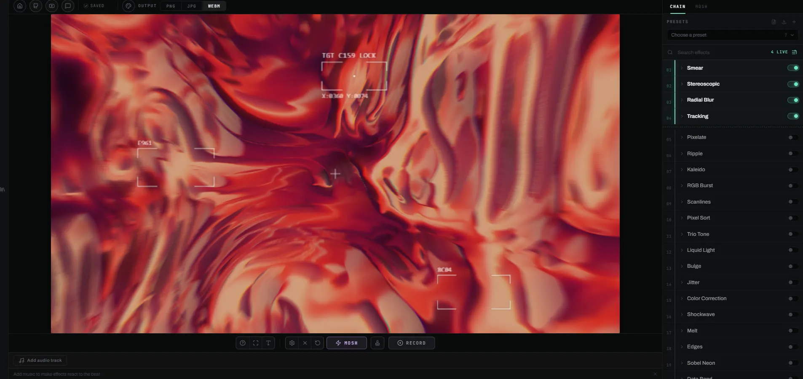
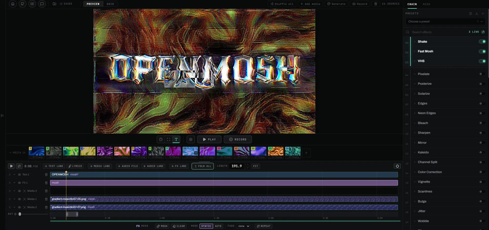

# OpenMosh



A browser-based glitch art studio, inspired by PhotoMosh. Drop in a photo or a video, pile on effects until it falls apart, hook the whole mess up to a song and export the result. It all runs in your browser, and nothing is uploaded.

**[Open the app](https://openmosh.com/)** · [About](https://openmosh.com/about) · [Changelog](CHANGELOG.md)



## How to use it

Pick a mode on the upload screen.

**Single** takes one image, video, GIF or SVG. Hit Mosh for a random stack of effects, then tweak them one by one, or lock the good ones and re-roll the rest. The Curated mosh style picks effects that work together. Add a track and any effect parameter can follow a frequency band of the song.



**Editor** is a timeline built around a song. Lay clips out on media layers, each with its own mosh, and run effect lanes over the whole frame, with text on a timeline of its own. Any piece of media can be cropped, keyed, erased by hand and run at its own speed. 3D models go on layers too (OBJ, STL, GLB, FBX, PLY), and animated GLB and FBX files play. An FBX needs its textures embedded.



**Slideshow** is the fast one. Throw in a pile of images or videos and it cuts between them on the beat, with effects firing on the grid. It detects your track's BPM, or you can set the tempo and length yourself.

There are 70 effects, from tame ones (pixelate, posterize, blur) through the usual glitch vocabulary (data bend, pixel sort, VHS, channel split) to ones that follow motion. A Mask effect limits the effects above it to a shape, a gradient, the bright parts of the picture, colors you pick, a painted area or an image you load. Anything with a clock can run free or lock to the beat.

Export is WebM or MP4 with audio. There's no GIF export, on purpose. Keyboard shortcuts live behind the shortcuts button in the app.

## Saving your work

Your work is kept in the browser's storage, and browsers can clear it, so save a file now and then.

- A project file holds one project with its media, song and fonts, and opens in the mode it came from: `.openmosh` (editor), `.openmosh-single` or `.openmosh-slideshow`.
- A backup (`.openmosh-backup`, from the storage dialog) holds everything the app has stored in this browser. Loading one merges it into what's already there.

## Requirements

OpenMosh is built and tested on recent Chromium browsers (Chrome, Edge, Brave, Arc). Firefox works, with a lower frame rate and slower exports. Safari may load it, but its support for the video encoder that export needs is newer and patchier. Touch devices only get Single mode.

- WebGL2 is required.
- WebCodecs handles video. Without a video encoder you can still edit, but not export. MP4 needs an H.264 encoder.
- Float render targets and 4096px textures are expected. Without them, glow and bloom look flatter and large media may not show right.

Any GPU from the last decade previews fine, and each live effect adds a shader pass. Video above 1080p gets a preview proxy, which you can turn off per file or with Optimize large videos in Settings. Export uses a hardware encoder when it finds one; otherwise WebM encodes across worker threads, so more cores finish sooner. 8 GB of RAM is comfortable, and 4K sources are what's most likely to make a machine struggle.

## Privacy

There's no backend, no account and no upload. Files are read straight off disk, everything renders locally and your browser writes the export. Your work stays on your device, and after the first visit the app runs offline too.

Two things go over the network, and only when you use them:

- The feedback form sends your message, your email if you give one, the screen you were on, your browser and screen size, and your effect chain with any caption text in it. It goes through [Web3Forms](https://web3forms.com/), which emails it to me. A report from the crash screen also carries the error and where in the code it happened, which can include a file name.
- A custom font added from a link is downloaded once from where the link points (Google Fonts, or the site hosting the file), then kept on your device. Project files carry their fonts inside, so opening one downloads nothing, except a Google Fonts link in a file saved by an older version.

## Development

Uses [bun](https://bun.sh), Svelte 5, Vite, TypeScript and WebGL2. BPM detection is our own, with no dependencies.

```bash
bun install        # Install dependencies
bun dev            # Start dev server (Vite)
bun run build      # Production build
bun preview        # Preview the production build
bun check          # TypeScript + Svelte type-check
bun test           # Unit suite (bun:test)
bun run test:e2e   # End-to-end suite (Playwright, tests/e2e)
```

## Contributing

Issues and pull requests are welcome. [CONTRIBUTING.md](CONTRIBUTING.md) has the setup, the conventions and how a change gets released. Security problems go in a regular issue too; see [SECURITY.md](SECURITY.md).

## Credits

[PhotoMosh](https://photomosh.com/) is what this is chasing.

- Effects ported from [X-PostProcessing-Library](https://github.com/QianMo/X-PostProcessing-Library) (RGB Burst, Screen Jump, Sobel Neon) and [Vidvox's ISF-Files](https://github.com/Vidvox/ISF-Files) (HSV Swap, RGB Strobe, Trio Tone, Circle Warp, Pixel Shifter, Ring Warp, Shockwave, Ghosting, Fast Mosh, Resize Glitch, Stylize Glitch, Motion Mask), both MIT.
- The crosswarp, cross zoom and cube transitions in the upload-screen demo come from [gl-transitions](https://gl-transitions.com/) (MIT).
- [mediabunny](https://github.com/Vanilagy/mediabunny) does the muxing and the proxy transcodes.
- [Draco](https://github.com/google/draco) (Apache 2.0) and [meshoptimizer](https://github.com/zeux/meshoptimizer) (MIT) unpack compressed models.
- [lucide](https://lucide.dev/) does the icons.
- Type is Archivo and JetBrains Mono via [Fontsource](https://fontsource.org/), plus the display faces in `public/fonts`, all under the SIL Open Font License.

## License

[MIT](LICENSE)
